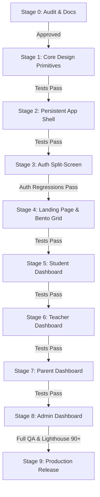

# 🗺️ EduSetu UI/UX Implementation Roadmap

**Execution Strategy:** Incremental, non-breaking, test-verified progression.  
**Rule:** No application code modification or stage advancement without prior stage test verification.

---

## Stage Breakdown & Gates

---

### Stage 0: Audit & Architecture Documentation (COMPLETED ✅)
- Inspect codebase dependencies, routing monolith, and visual patterns.
- Deliver: `docs/UI_UX_AUDIT.md`, `docs/DESIGN_SYSTEM_SPEC.md`, `docs/UI_UX_IMPLEMENTATION_ROADMAP.md`.

---

### Stage 1: Design System Primitives & Tokens (Next ⏳)
- **Goal:** Create zero-dependency, accessible component primitives inside `client/src/components/ui/`:
  - `Button.jsx`
  - `Input.jsx`
  - `Card.jsx`
  - `Badge.jsx`
  - `Skeleton.jsx`
  - `Toast.jsx` & `ToastContext.jsx`
- **Verification Gate:**
  - Create unit tests for every UI primitive (`Button.test.jsx`, `Input.a11y.test.jsx`).
  - Verify WCAG focus outlines and contrast.

---

### Stage 2: Application Shell & Persistent Navigation
- **Goal:** Create a responsive, persistent shell (`AppShell.jsx`):
  - Collapsible sidebar for authenticated views with active route indicators.
  - Slim header with notifications bell, user avatar, and role badge.
  - Mobile bottom navigation bar for quick student/teacher actions.
- **Verification Gate:**
  - Zero disruption to current routing in `App.jsx`.

---

### Stage 3: Split-Screen Authentication Experience
- **Goal:** Redesign `LoginPage.jsx` and `RegisterPage.jsx`:
  - 50/50 desktop split layout (Left: Branded illustrations & real live stats; Right: Clean auth form).
  - Prominent "Continue with Google" one-click button.
  - Accessible 6-digit OTP boxes with paste support and cooldown timer.
- **Verification Gate:**
  - Google Login and Brevo OTP registration must pass end-to-end.
  - Backend role authorization remains untouched.

---

### Stage 4: High-Converting Landing Page & Bento Grid
- **Goal:** Modernize Home overview in `App.jsx`:
  - Clean hero with interactive role-preview tabs (Student, Teacher, Parent).
  - 6-part feature Bento Grid showcasing real EduSetu capabilities.
  - Trust badges, feature deep-dives, and responsive footer.

---

### Stages 5 - 8: Role Dashboards Modernization
- **Stage 5 (Student):** Progress rings for attendance, timetable card, AI Doubt solver widget.
- **Stage 6 (Teacher):** Class roster, quick attendance toggle pills, homework grading queue.
- **Stage 7 (Parent):** Child learning feed, attendance alerts, teacher chat drawer.
- **Stage 8 (Admin):** Clean analytics overview, user approval tables, audit log viewer.

---

### Stage 9: QA, Performance & Production Release
- Full Lighthouse performance and accessibility audit (target 90+).
- Cross-browser and responsive testing (360px mobile up to 1920px desktop).
- Final Git push to Render production.
